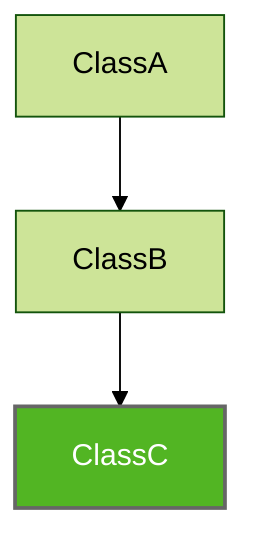

# Indirect Parents

The `indirectParents` parameter (`parents()`, `hasParentClasses()`, `hasAllParentInterfacesOf()` methods etc.) specifies whether or not to retrieve parents of the parent (indirect parents). By default, `indirectParents` is `false` e.g.



For the above inheritance hierarchy it is possible to retrieve:

1. Direct parents of `ClassC` (`ClassB`):

```kotlin
Konsist
	.scopeFromProject()
	.classes()
	.first { it.name == "ClassC" }
	.parents() // ClassB
```

2. All parents present in the codebase hierarchy (`ClassB` and `ClassA`):

```kotlin
Konsist
	.scopeFromProject()
	.classes()
	.first { it.name == "ClassC" }
	.parents(indirectParents = true) // ClassB, ClassA
```

Parents declared outside the project codebase (library and Kotlin standard library types) are also returned. With `indirectParents = true` parents of such parents are read from the test classpath, so the library must be on it (parents missing from the classpath are skipped):

```kotlin
// Library
open class LibraryClass : LibraryInterface
interface LibraryInterface

// Project
class ClassD : LibraryClass()
```

```kotlin
Konsist
	.scopeFromProject()
	.classes()
	.first { it.name == "ClassD" }
	.parents(indirectParents = true) // LibraryClass, LibraryInterface
```


For library and Kotlin parents `sourceDeclaration` is an external declaration (`isExternal`) or Kotlin type (`isKotlinType`), so casts such as `asClassDeclaration()` return `null` - these casts return only declarations from the project codebase.

