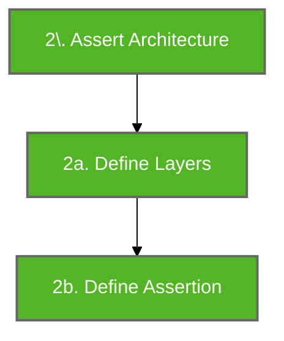
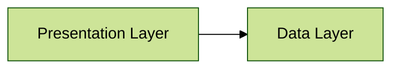

# Architecture Assertion

Architecture assertions are used to perform architecture verification. It is the final step of Konsist verification preceded by scope creation ([koscope.md](koscope.md "mention")):



## Assert Architecture

As an example, this simple 2-layer architecture will be used:



The `assertArchitecture` block defines architecture layer rules and verifies that the layer requirements are met.

```kotlin
Konsist
    .scopeFromProduction()
    .assertArchitecture { 
        // Assert architecture 
    }
```


Use `scopeFromProduction()` for architecture checks. Test sources often share packages with production code (e.g. `com.myapp.domain`), so with `scopeFromProject()` test files become part of production layers. Imports used only by tests (fakes, test adapters) can then be reported as violations (e.g. by `dependsOnNothing` or `doesNotDependOn`).


## Define Layers

Create a `Layer` class instance to represent project layers. Each `Layer` instance accepts the `name` (used for presenting architecture violation errors) and `rootPackage` used to define the architectural layer:

```kotlin
Konsist
    .scopeFromProduction()
    .assertArchitecture {
        // Define layers
        val presentation = Layer("Presentation", "com.myapp.presentation..")
        val data = Layer("Data", "com.myapp.data..")
    }
```


The inclusion of two trailing dots indicates that the layer is denoted by the `com.myapp.presentation` package together with all of its sub-packages.


## Define Architecture Assertions

The final step is to define the dependencies (relations) between each layer using one of these methods:

* `dependsOn`
* `dependsOnNothing`
* `doesNotDependOn`

The above methods follow up the layer definitions inside `assertArchitecture` block:

```kotlin
Konsist
    .scopeFromProduction()
    .assertArchitecture {
        val presentation = Layer("Presentation", "com.myapp.presentation..")
        val data = Layer("Data", "com.myapp.data..")

        // Define dependencies 
        presentation.dependsOn(data)
        data.dependsOnNothing()
    }
```

## Strict DependsOn

By default, the `dependsOn` method does not perform strict layer validation (`strict = false`). However, this behaviour is controlled by the `strict` parameter:

* `strict = false` (default) - may depend on layer
* `strict = true`  - have to depend on layer

e.g.

```kotlin
// Optional dependency - Feature layer may depend on Domain layer
featureLayer.dependsOn(domainLayer) // strict = false by default

// Required dependency - Feature layer must depend on Domain layer
featureLayer.dependsOn(domainLayer, strict = true)
```

## What Each Rule Checks

A layer is _declared_ when it is used in any rule (`dependsOn`, `doesNotDependOn`, `dependsOnNothing`, `include`) inside the `assertArchitecture` block. Rules only look at imports of declared layers. Imports of packages that do not belong to any declared layer (e.g. `kotlin..`, `android..`, third-party libraries, undeclared packages) are ignored.

| Rule                            | Passes when                                                                   |
| ------------------------------- | ----------------------------------------------------------------------------- |
| `a.dependsOn(b)`                | Always. Imports are not checked. `a` and `b` become declared layers and `a -> b` is used for circular dependency detection |
| `a.dependsOn(b, strict = true)` | At least one file in `a` imports `b`. Imports of other declared layers are not checked |
| `a.doesNotDependOn(b)`          | `a` does not import `b`. Imports of other declared layers are allowed          |
| `a.dependsOnNothing()`          | `a` does not import any other declared layer                                  |
| `a.include()`                   | Always. No rule for `a`, but `a` becomes a declared layer, so other layers' `dependsOnNothing` rules forbid importing it |


`dependsOn` does not forbid dependencies on other layers. To forbid a dependency use `doesNotDependOn` (or `dependsOnNothing` for an independent layer).



Only `import` directives are checked. A fully qualified reference without an import (e.g. `com.myapp.data.Repository()`) is not detected.


## Preconditions

Before verifying dependencies Konsist checks the architecture configuration and throws `KoPreconditionFailedException` when:

* `Architecture doesn't contain layers or dependencies.` - the `assertArchitecture` block does not declare any layer.
* `Layer X doesn't contain any files.` - a declared layer does not match any file in the scope. Every declared layer must contain at least one file.
* `Layer name must be unique. Duplicated name: 'X'.` / `Layer rootPackage must be unique. Duplicated rootPackage: 'x..'.` - two `Layer` instances use the same `name` or `rootPackage`. This also applies to two equal instances created separately (e.g. by a `get()` property), so create each layer once and reuse it.

Common causes of the empty layer error:

* A typo in the layer package (`com.myapp.dmain..`).
* The scope does not contain the module or source set where the layer lives (e.g. `scopeFromModule("app")` while the layer is in the `core` module).

## Excluding Files

Architecture verification can be performed on `KoScope` (as seen above) and a list of `KoFileDeclaration`s. For example, you can remove a few files from the scope before performing an architectural check:

```kotlin
Konsist
    .scopeFromProduction()
    .files
    .withoutNameStartingWith("Repository")
    .assertArchitecture {
        val presentation = Layer("Presentation", "com.myapp.presentation..")
        val data = Layer("Data", "com.myapp.data..")

        presentation.dependsOn(data)
        data.dependsOnNothing()
    }
```

This approach provides more flexibility when working with complex projects; however, the desired approach is to create a dedicated scope. See [koscope.md](koscope.md "mention").


Architecture assertions do not support suppression with `@Suppress`. To skip files, remove them from the scope (or file list) before calling `assertArchitecture`.


## Include Layer Without Defining Dependency

The `include` method allows including a layer in architecture verification without defining a dependency for this layer:

```kotlin
private val domain = Layer("Domain",  "com.domain..")
private val presentation = Layer("Presentation", "com.presentation..")

Konsist
    .scopeFromProduction()
    .assertArchitecture {
        // Include presentation for architectural check without defining a dependency
        presentation.include()
        
        // Include domain layer for architectural check and define no dependency (independent)
        domain.dependsOnNothing()
    }
```

## Architecture As A Variable

Architecture configuration can be defined beforehand and stored in a variable to facilitate checks for multiple scopes:&#x20;

```kotlin
// Define architecture
val architecture = architecture {
        val presentation = Layer("Presentation", "com.myapp.presentation..")
        val data = Layer("Data", "com.myapp.data..")

        presentation.dependsOn(data)
        data.dependsOnNothing()
}

// Assert Architecture of two modules using common architecture rules
moduleFeature1Scope.assertArchitecture(architecture)
moduleFeature2Scope.assertArchitecture(architecture)
```

This approach may be helpful when refactoring existing applications. To facilitate readability the above checks should be expressed as two unit tests:

```kotlin
class ArchitectureTest {
    private val architecture = architecture {
        val presentation = Layer("Presentation", "com.myapp.presentation..")
        val data = Layer("Data", "com.myapp.data..")

        presentation.dependsOn(data)
        data.dependsOnNothing()
    }

    @Test
    fun `architecture layers of feature1 module have dependencies correct`() {
        moduleFeature1Scope.assertArchitecture(architecture)
    }
    
    @Test
    fun `architecture layers of feature2 module have dependencies correct`() {
        moduleFeature2Scope.assertArchitecture(architecture)
    }
}
```

