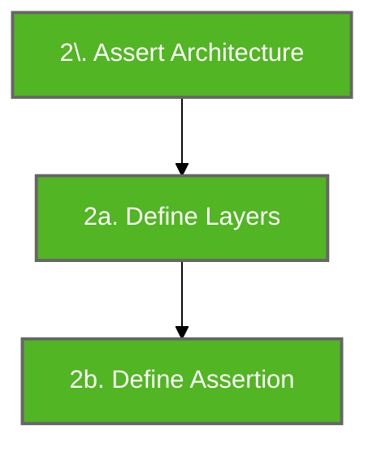
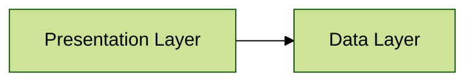

# Architecture Assertion

Architecture assertions are used to perform architecture verification. It is the final step of Konsist verification preceded by scope creation ([koscope.md](koscope.md "mention")):



## Assert Architecture

As an example, this simple 2-layer architecture will be used:



The `assertArchitecture` block defines architecture layer rules and verifies that the layer requirements are met.

```kotlin
Konsist
    .scopeFromProduction()
    .assertArchitecture { 
        // Assert architecture 
    }
```


Use `scopeFromProduction()` for architecture checks. Test sources often share packages with production code (e.g. `com.myapp.domain`), so with `scopeFromProject()` test files become part of production layers. Imports used only by tests (fakes, test adapters, other layers) are then reported as architecture violations, and test files in other packages (e.g. Konsist tests) are reported as files that reside in no layer (see [#files-outside-layers](architecture-assert.md#files-outside-layers "mention")).


## Define Layers

Create a `Layer` class instance to represent project layers. Each `Layer` instance accepts the `name` (used for presenting architecture violation errors) and `rootPackage` used to define the architectural layer:

```kotlin
Konsist
    .scopeFromProduction()
    .assertArchitecture {
        // Define layers
        val presentation = Layer("Presentation", "com.myapp.presentation..")
        val data = Layer("Data", "com.myapp.data..")
    }
```


The inclusion of two trailing dots indicates that the layer is denoted by the `com.myapp.presentation` package together with all of its sub-packages.


### Single Package Layer

A `rootPackage` without trailing `..` covers a single package only. Files in its sub-packages do not belong to this layer, so a single package layer does not overlap layers defined in its sub-packages:

```kotlin
Konsist
    .scopeFromProduction()
    .assertArchitecture {
        val app = Layer("App", "com.myapp") // matches "com.myapp" only, not "com.myapp.domain"
        val domain = Layer("Domain", "com.myapp.domain..")
        val data = Layer("Data", "com.myapp.data..")

        app.dependsOn(domain)
        data.dependsOn(domain)
        domain.dependsOnNothing()
    }
```

### Optional Layer

By default, every declared layer must contain at least one file (see [#preconditions](architecture-assert.md#preconditions "mention")). This helps to detect typos in layer packages. Set `optional = true` for a layer that may not contain any files yet:

```kotlin
val data = Layer("Data", "com.myapp.data..", optional = true)
```

Strict dependencies (`dependsOn(..., strict = true)`) of an empty optional layer are not checked. A strict dependency of another layer **on** an empty optional layer still fails, because no file can import it.

## Define Architecture Assertions

The final step is to define the dependencies (relations) between each layer using one of these methods:

* `dependsOn`
* `dependsOnNothing`
* `doesNotDependOn`

The above methods follow up the layer definitions inside `assertArchitecture` block:

```kotlin
Konsist
    .scopeFromProduction()
    .assertArchitecture {
        val presentation = Layer("Presentation", "com.myapp.presentation..")
        val data = Layer("Data", "com.myapp.data..")

        // Define dependencies 
        presentation.dependsOn(data)
        data.dependsOnNothing()
    }
```

## Strict DependsOn

By default, the `dependsOn` method does not perform strict layer validation (`strict = false`). However, this behaviour is controlled by the `strict` parameter:

* `strict = false` (default) - may depend on layer
* `strict = true`  - have to depend on layer

e.g.

```kotlin
// Optional dependency - Feature layer may depend on Domain layer
featureLayer.dependsOn(domainLayer) // strict = false by default

// Required dependency - Feature layer must depend on Domain layer
featureLayer.dependsOn(domainLayer, strict = true)
```

## What Each Rule Checks

A layer is _declared_ when it is used in any rule (`dependsOn`, `doesNotDependOn`, `dependsOnNothing`, `include`) inside the `assertArchitecture` block. Rules only look at imports of declared layers. Imports of packages that do not belong to any declared layer (e.g. `kotlin..`, `android..`, third-party libraries, undeclared packages) are ignored.

| Rule                            | Passes when                                                                   |
| ------------------------------- | ----------------------------------------------------------------------------- |
| `a.dependsOn(b)`                | `a` does not import any declared layer other than `b` and other layers passed to `a.dependsOn` (imports of `a` itself are allowed) |
| `a.dependsOn(b, strict = true)` | Same as above, and at least one file in `a` imports `b`                        |
| `a.doesNotDependOn(b)`          | `a` does not import `b`. Imports of other declared layers are allowed          |
| `a.dependsOnNothing()`          | `a` does not import any other declared layer                                  |
| `a.include()`                   | Always. No rule for `a`, but `a` becomes a declared layer, so other layers' `dependsOn` and `dependsOnNothing` rules forbid importing it |


Only `import` directives are checked. A fully qualified reference without an import (e.g. `com.myapp.data.Repository()`) is not detected.


The package of the imported declaration is matched against the layer, not the whole import name. Trailing import segments starting with an uppercase letter (classes, objects) are not treated as packages:

* `import com.myapp.model.Data` resides in the `com.myapp.model` package, so it does not belong to the `..data..` layer.
* `import com.myapp.data.Repository`, `import com.myapp.data.Repository.Nested`, `import com.myapp.data.topLevelFunction` and `import com.myapp.data.*` belong to the `com.myapp.data..` layer.

### Files Outside Layers

By default, every file in the scope must reside in exactly one declared layer. Files that reside in no layer (including files without a package) fail the assertion:

```
'architecture layers have correct dependencies' test has failed. 
All files are required to reside in a layer, but these files reside in no layer:
└── File file:///project/app/src/main/kotlin/com/myapp/util/StringUtil.kt
```

To fix it, declare a layer for these files (e.g. with `include()`), remove them from the scope (see [#excluding-files](architecture-assert.md#excluding-files "mention")) or set `allowFilesOutsideLayers = true` to ignore files that reside in no layer:

```kotlin
Konsist
    .scopeFromProduction()
    .assertArchitecture(allowFilesOutsideLayers = true) {
        val presentation = Layer("Presentation", "com.myapp.presentation..")
        val data = Layer("Data", "com.myapp.data..")

        presentation.dependsOn(data)
        data.dependsOnNothing()
    }
```

A file that resides in more than one layer always fails, regardless of `allowFilesOutsideLayers` (see [#preconditions](architecture-assert.md#preconditions "mention")).

### Failure Messages

Each failing file lists only the imports that break the rule:

| Rule                            | Failure message                                                                                        |
| ------------------------------- | ------------------------------------------------------------------------------------------------------ |
| `a.dependsOn(b)`                | `'A' layer depends on 'C' layer, but this dependency is not declared. Files that depend on 'C' layer:` |
| `a.dependsOn(b, strict = true)` | `'A' layer is required to depend on 'B' layer (strict), but has no dependency on it.`                  |
| `a.doesNotDependOn(b)`          | `'A' layer should not depend on 'B' layer but has dependencies in files:`                              |
| `a.dependsOnNothing()`          | `'A' layer should not depend on anything but has dependencies in files:`                               |
| File outside layers             | `All files are required to reside in a layer, but these files reside in no layer:`                     |

```
'presentation layer has correct dependencies' test has failed. 
'Presentation' layer depends on 'Data' layer, but this dependency is not declared. Files that depend on 'Data' layer:
└── File file:///project/app/src/main/kotlin/com/myapp/presentation/PresentationClass.kt
    └── Import com.myapp.data.DataClass (file:///project/app/src/main/kotlin/com/myapp/presentation/PresentationClass.kt:3:1)
```

## Preconditions

Before verifying dependencies Konsist checks the architecture configuration and throws `KoPreconditionFailedException` when:

* `Architecture doesn't contain layers or dependencies.` - the `assertArchitecture` block does not declare any layer.
* `Layer X doesn't contain any files.` - a declared layer does not match any file in the scope. Every declared layer must contain at least one file, unless it is optional (see [#optional-layer](architecture-assert.md#optional-layer "mention")).
* `Layers overlap. Each file must belong to only one layer:` - a file belongs to more than one layer (e.g. `com.myapp..` and `com.myapp.domain..`). The message lists the overlapping layers and their shared files. Use a single package layer (`com.myapp`) to avoid the overlap (see [#single-package-layer](architecture-assert.md#single-package-layer "mention")).
* `Layer name must be unique. Duplicated name: 'X'.` / `Layer rootPackage must be unique. Duplicated rootPackage: 'x..'.` - two different layers use the same `name` or `rootPackage`. Equal `Layer` instances (same `name`, `rootPackage` and `optional`, e.g. created by a `get()` property) are treated as the same layer.

Common causes of the empty layer error:

* A typo in the layer package (`com.myapp.dmain..`).
* The scope does not contain the module or source set where the layer lives (e.g. `scopeFromModule("app")` while the layer is in the `core` module).

## Assertion Parameters

`assertArchitecture` accepts the following optional parameters:

* `additionalMessage` - message displayed with the failing test.
* `testName` - test name displayed in the failure message (see [#test-name](declaration-assert.md#test-name "mention")).
* `allowFilesOutsideLayers` - ignore files that reside in no layer (default `false`, see [#files-outside-layers](architecture-assert.md#files-outside-layers "mention")).
* `rule` - `KoRule` displayed in the failure message (see [#rule](declaration-assert.md#rule "mention")).

```kotlin
Konsist
    .scopeFromProduction()
    .assertArchitecture(
        rule = KoRule(
            id = "ARCH-001",
            title = "Data layer must not depend on other layers.",
            reason = "Data layer is reused by multiple features.",
        ),
    ) {
        val presentation = Layer("Presentation", "com.myapp.presentation..")
        val data = Layer("Data", "com.myapp.data..")

        presentation.dependsOn(data)
        data.dependsOnNothing()
    }
```

## Excluding Files

Architecture verification can be performed on `KoScope` (as seen above) and a list of `KoFileDeclaration`s. For example, you can remove a few files from the scope before performing an architectural check:

```kotlin
Konsist
    .scopeFromProduction()
    .files
    .withoutNameStartingWith("Repository")
    .assertArchitecture {
        val presentation = Layer("Presentation", "com.myapp.presentation..")
        val data = Layer("Data", "com.myapp.data..")

        presentation.dependsOn(data)
        data.dependsOnNothing()
    }
```

This approach provides more flexibility when working with complex projects; however, the desired approach is to create a dedicated scope. See [koscope.md](koscope.md "mention").


Architecture assertions do not support suppression with `@Suppress`. To skip files, remove them from the scope (or file list) before calling `assertArchitecture`.


## Include Layer Without Defining Dependency

The `include` method allows including a layer in architecture verification without defining a dependency for this layer:

```kotlin
private val domain = Layer("Domain",  "com.domain..")
private val presentation = Layer("Presentation", "com.presentation..")

Konsist
    .scopeFromProduction()
    .assertArchitecture {
        // Include presentation for architectural check without defining a dependency
        presentation.include()
        
        // Include domain layer for architectural check and define no dependency (independent)
        domain.dependsOnNothing()
    }
```

## Architecture As A Variable

Architecture configuration can be defined beforehand and stored in a variable to facilitate checks for multiple scopes:&#x20;

```kotlin
// Define architecture
val architecture = architecture {
        val presentation = Layer("Presentation", "com.myapp.presentation..")
        val data = Layer("Data", "com.myapp.data..")

        presentation.dependsOn(data)
        data.dependsOnNothing()
}

// Assert Architecture of two modules using common architecture rules
moduleFeature1Scope.assertArchitecture(architecture)
moduleFeature2Scope.assertArchitecture(architecture)
```

This approach may be helpful when refactoring existing applications. To facilitate readability the above checks should be expressed as two unit tests:

```kotlin
class ArchitectureTest {
    private val architecture = architecture {
        val presentation = Layer("Presentation", "com.myapp.presentation..")
        val data = Layer("Data", "com.myapp.data..")

        presentation.dependsOn(data)
        data.dependsOnNothing()
    }

    @Test
    fun `architecture layers of feature1 module have dependencies correct`() {
        moduleFeature1Scope.assertArchitecture(architecture)
    }
    
    @Test
    fun `architecture layers of feature2 module have dependencies correct`() {
        moduleFeature2Scope.assertArchitecture(architecture)
    }
}
```

