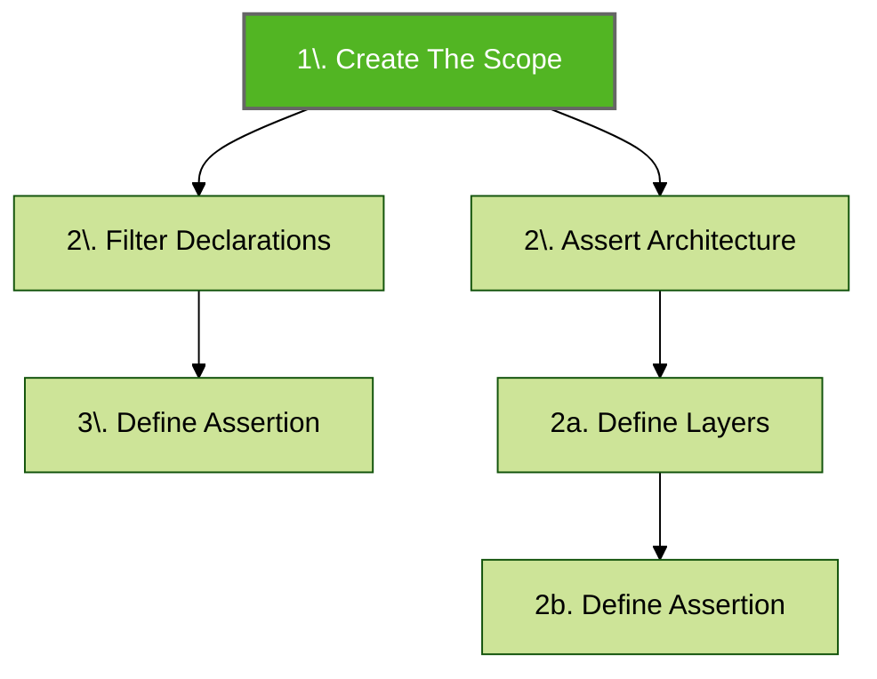
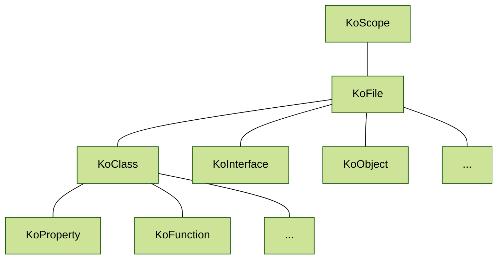

# Create The Scope

Scope represents a set of Kotlin files to be further queried, filtered ([declaration-query-and-filter.md](declaration-query-and-filter.md "mention")), and verified ([declaration-assert.md](declaration-assert.md "mention")).


Scopes are an alternative to a `baseline` file. Subsets of the codebase can be refactored to be aligned with Konsist tests e.g. code in a single module.




Every scope contains a set of `KoFile` instances. Every `KoFile` instance contains the declarations (see [declaration.md](../features/declaration.md "mention")) representing code entities present in the file e.g.:




Konsist is built on top of [Kotlin Compiler Psi](https://github.com/JetBrains/kotlin/tree/master/compiler/psi/src/org/jetbrains/kotlin/psi). It wraps the Kotlin compiler parser and provides a simple API to access Kotlin codebase declarations. Konsist [declaration.md](../features/declaration.md "mention") tree mimics the Kotlin code structure.


The scope can be created for an entire project, module, package, and Kotlin file.

The scope is dynamically built based on the Kotlin files present in the project, enabling it to adapt seamlessly as the project evolves. For instance, when the scope is set to encapsulate a specific module, any additional file introduced to that module will be automatically incorporated into the scope. This ensures that the scope consistently offers thorough and current coverage.


To execute Konsist tests, the Konsist dependency must be integrated into a module. Yet, by integrating Konsist into a single module (e.g. `app` module), Konsist can still access the entire project. The specific files evaluated are determined by the evolving scope that's been defined.


## Scope Creation

Various methods can be used to obtain instances of the scope. This allows the definition of more granular Konsist tests e.g. tests covering only certain modules, source sets, packages, or folders.


See [add-konsist-existing-project.md](../features/add-konsist-existing-project.md "mention").


### Project Scope

The widest scope is the scope containing all Kotlin files present inside the project:

```kotlin
Konsist.scopeFromProject() // All Kotlin files present in the project
```


Project scopes (`scopeFromProject`, `scopeFromModule`, `scopeFromPackage`, `scopeFromSourceSet`, `scopeFromProduction` and `scopeFromTest`) contain only Kotlin files located in the module `src` directory. Kotlin files located outside of it are ignored, e.g. `app/Script.kt`, `app/testData/Fixture.kt` and `app/build/Generated.kt`. Use [Directory Scope](#directory-scope) or [File Scope](#file-scope) to verify these files.


To print a list of files within `koScope` use the `koScope.print()` method:

```kotlin
Konsist
    .scopeFromProject()
    .print()
```


To review the scope content in more detail see [debug-konsist-test.md](../features/debug-konsist-test.md "mention").


### Production Codebase

The `scopeFromProduction` method allows the creation of a scope containing only production code (equivalent to `Konsist.scopeFromProject() - Konsist.scopeFromTest()`):

```kotlin
Konsist.scopeFromProduction()
```

Contains:

```
project/
├─ app/
│  ├─ main/   <--- scope contains all production code files
│  │  ├─ App.kt
│  ├─ test/
│  │  ├─ AppTest.kt
├─ core/
│  ├─ main/   <--- scope contains all production code files
│  │  ├─ Core.kt
│  ├─ test/
│  │  ├─ CoreTest.kt
```

### Test Codebase

The `scopeFromTest` method allows the creation of a scope containing only test code:

```kotlin
Konsist.scopeFromTest()
```

Contains:

```
project/
├─ app/
│  ├─ main/
│  │  ├─ App.kt
│  ├─ test/   <--- scope contains all test code files
│  │  ├─ AppTest.kt
├─ core/
│  ├─ main/
│  │  ├─ Core.kt
│  ├─ test/   <--- scope contains all test code files
│  │  ├─ CoreTest.kt
```

### Module Scope

The `scopeFromModule` method allows the creation of more granular scopes based on the module name e.g. creating a scope containing all Kotlin files present in the `app` module:

```kotlin
Konsist.scopeFromModule(":app")
```

Contains:

```
project/
├─ app/   <--- scope contains all files from the 'app' module
│  ├─ main/
│  │  ├─ App.kt
│  ├─ test/
│  │  ├─ AppTest.kt
├─ core/
│  ├─ main/
│  │  ├─ Core.kt
│  ├─ test/
│  │  ├─ CoreTest.kt
```

The module name can be passed in any of these formats:

* Gradle project path, e.g. `:feature:auth` or `feature:auth` (preferred)
* Directory path with `/` or `\` separators, e.g. `feature/auth` or `feature\auth` (both accepted on all OSes)

The top-level (root) module can be referenced as `:` or `root`. Module names are case-sensitive on all OSes (`:App` does not match the `app` directory).


Konsist resolves the module name to a directory relative to the project root (`:feature:auth` -> `feature/auth`). Gradle modules with a custom `projectDir` (set in `settings.gradle.kts`) must be referenced by their directory path.



`scopeFromModule` returns an empty scope when the module does not exist (e.g. misspelled module name or wrong case). Assertions on an empty list pass by default, so a misspelled module name can silently disable the test. Use the [strict](declaration-assert.md#strict) assertion parameter to make the test fail when the declaration list is empty.


This approach may be helpful when refactoring an existing project module by module.

```kotlin
val refactoredModule1Scope = Konsist.scopeFromModule(":refactoredModule1")
val refactoredModule2Scope = Konsist.scopeFromModule(":refactoredModule2")

val scope = refactoredModule1Scope + refactoredModule2Scope

scope
   .classes()
   ...
   .assertTrue { /*..*/ }
```

### Nested Module Scope

A nested module is a module that exists within another module.

Consider this `feature` module existing inside `app` module:

```
project/
├─ app/
│  ├─ feature/   <--- scope contains all files from the 'app/feature' module
│  │  ├─ src/main/kotlin/
│  │  │  ├─ Feature.kt
```

To narrow the scope to `feature` module use:

```kotlin
Konsist.scopeFromModule(":app:feature")
```

Modules can be nested at any depth (e.g. `:app:feature:payment`). The module name is always the full path from the project root, so `scopeFromModule(":feature")` does not match the `app/feature` module.

The parent module scope contains only the parent module files - files of nested modules are not included:

```
project/
├─ app/   <--- scope contains only files from the 'app' module
│  ├─ src/main/kotlin/
│  │  ├─ App.kt
│  ├─ feature/
│  │  ├─ src/main/kotlin/
│  │  │  ├─ Feature.kt
```

```kotlin
Konsist.scopeFromModule(":app")
```

To include the parent module and its nested modules pass all of them:

```kotlin
Konsist.scopeFromModule(":app", ":app:feature")
```

or use the `..` wildcard, which matches any number of module directories (including none):

```kotlin
Konsist.scopeFromModule(":app..")        // 'app' module and all modules nested inside it
Konsist.scopeFromModule("..data")        // every 'data' module, e.g. 'data', 'feature/data', 'feature/auth/data'
Konsist.scopeFromModule(":app..data")    // 'data' modules nested at any depth inside 'app'
Konsist.scopeFromModule("..")            // all modules
```

The wildcard works with every method accepting a module name, e.g. the `moduleName` parameter of `scopeFromProject`, `scopeFromPackage`, `scopeFromProduction` and `scopeFromTest`, as well as `residesInModule`, `withModule` and `withoutModule`:

```kotlin
Konsist
    .scopeFromProject()
    .classes()
    .withModule(":app..")
```

Module names without `..` must match exactly, so `:app` does not include `:app:feature`.


Use `..` (or `:..`) to match all modules. `root..` matches only the root module and modules located in a directory named `root`.


The `moduleName` property of a nested module declaration returns the directory path with `/` separators on all OSes (e.g. `app/feature`).


A project located inside a source set directory is not a nested module. Its files belong to the module containing
the source set. A source set directory is a directory containing a `kotlin`, `java` or `resources` directory
(e.g. `app/src/test`).

```text
app/
└── src/
    ├── main/kotlin/AppMain.kt
    └── test/
        ├── kotlin/AppTest.kt
        ├── resources/project/src/main/kotlin/Fixture.kt
        └── testData/project/src/main/kotlin/Fixture.kt
```

Both `Fixture.kt` files reside in the `app` module and the `test` source set:

```kotlin
Konsist.scopeFromProduction(moduleName = ":app") // AppMain.kt
Konsist.scopeFromTest(moduleName = ":app")       // AppTest.kt and both Fixture.kt files
Konsist.scopeFromModule(":app:src:test:testData:project") // empty scope
```


### Source Set Scope

The `scopeFromSourceSet` method allows the creation of more granular scopes based on the source set name e.g. create a scope containing all Kotlin files present in the `test` source set:

```kotlin
Konsist.scopeFromSourceSet("test")
```

Contains:

```
project/
├─ app/
│  ├─ main/
│  │  ├─ App.kt
│  ├─ test/   <--- scope contains all files from the 'test' directory
│  │  ├─ AppTest.kt
├─ core/
│  ├─ main/
│  │  ├─ Core.kt
│  ├─ test/   <--- scope contains all files from the 'test' directory
│  │  ├─ CoreTest.kt
```

### Module and Source Set Scope

To retrieve scope by using both module and source set use the `scopeFromProject` method with `moduleName` and `sourceSetName` arguments:

```kotlin
Konsist.scopeFromProject(moduleName = ":app", sourceSetName = "test")
```

The `moduleName` argument (also available in `scopeFromProduction`, `scopeFromTest` and `scopeFromPackage`) accepts the same formats as `scopeFromModule` and returns an empty scope when the module does not exist.

Contains:

```

project/
├─ app/
│  ├─ main/
│  │  ├─ App.kt
│  ├─ test/   <--- scope contains all files from the 'test' directory
│  │  ├─ AppTest.kt
├─ core/
│  ├─ main/
│  │  ├─ Core.kt
│  ├─ test/
│  │  ├─ CoreTest.kt
```


### Package Scope

The `scopeFromPackage` method allows the creation of a scope containing code present in a given package e.g. `com.usecase` package:

```kotlin
Konsist.scopeFromPackage("com.usecase..")
```

Contains:

```
project/
├─ app/
│  ├─ main/
│  │  ├─ com/
│  │  │  ├─ usecase/
│  │  │  │  ├─ UseCase.kt <--- scope contains files present in 'com.usecase' package
│  ├─ test/
│  │  ├─ com/
│  │  │  ├─ usecase/
│  │  │  │  ├─ UseCaseTest.kt <--- scope contains files present in 'com.usecase' package
```


The double dots (`..`) syntax means zero or more packages. Check the [packageselector.md](../features/packageselector.md "mention") page.


### Directory Scope

The `scopeFromDirectory` method allows the creation of a scope containing code present in a given project folder e.g. `domain` directory. Unlike project scopes, it also contains Kotlin files located outside the module `src` directory:

```kotlin
val myScope = Konsist.scopeFromDirectory("app/domain")
```

Contains:

```
project/
├─ app/
│  ├─ main/
│  │  ├─ com/
│  │  │  ├─ domain/  <--- scope contains files present in 'domain' folder
```

## File Scope

It is also possible to create scope from one or more file paths:

```kotlin
val myScope = Konsist.scopeFromFile("app/main/domain/UseCase.kt")
```

It is also possible to create the scope from a list of files. This can help with certain development workflows e.g. running Konsist tests only on files modified in a given PR:

```kotlin
val filePaths = listOf("/domain/UseCase1.kt", "/domain/UseCase2.kt")
val myScope = Konsist.scopeFromFiles(filePaths)
```

## Scope Slice

For even more granular control you can use the `KoScope.slice` method to retrieve a scope containing a subset of files from the given scope:

```kotlin
// scope containing all files in any 'test' directory (works with '/' and '\' separators)
koScope.slice { it.resideInPath("..test..") }

// scope containing all files in 'com.domain.usecase' package
koScope.slice { it.hasPackage("com.domain.usecase") }

// scope containing all files in 'usecase' package and its sub-packages
koScope.slice { it.hasPackage("..usecase..") }

// scope containing all files in modules with name ending with '-ui' e.g. ':feature:auth-ui'
koScope.slice { it.moduleName.endsWith("-ui") }

// scope containing all files except files from the 'legacy' module
koScope.slice { !it.resideInModule(":legacy") }

// scope containing all files except files in any 'generated' directory
koScope.slice { !it.resideInPath("..generated..") }
```


Project files are parsed once and cached, so slicing `Konsist.scopeFromProject()` does not parse files again.


## Scope Reuse

### Reuse Scope In Test Class

To reuse the scope across the test class, define the scope in the companion object and access it from multiple tests:

<pre class="language-kotlin"><code class="lang-kotlin">// Test.kt
class DataTest {
<strong>    @Test
</strong>    fun `test 1`() {
        classesScope
            .assertTrue { /* .. */ }
    }

    @Test
    fun `test 2`() {
        classesScope
            .assertTrue { /* .. */ }
    }
    
    companion object {
        // Create a new KoScope once for all tests
        private val classesScope = Konsist
            .scopeFromProject()
            .classes()
    }
}
</code></pre>

### Reuse Scope In Test Source Set

To reuse the scope across multiple test classes, define the scope in a file and access it from multiple test classes:

```kotlin
// Scope.kt in "test" source set
val projectScope = Konsist.scopeFromProject() // Create a new KoScope

// AppKonsistTest.kt
class AppKonsistTest {
    @Test
    fun `test 1`() {
        projectScope
            .objects()
            .assertTrue { /* .. */ }
    }
}

// CoreKonsistTest.kt
class CoreKonsistTest {
    @Test
    fun `test 1`() {
        projectScope
            .classes()
            .assertTrue { /* .. */ }
    }

    @Test
    fun `test 2`() {
        projectScope
            .interfaces()
            .assertTrue { /* .. */ }
    }
}
```

Here is the file structure representing the above snippet:

```
project/
├─ app/
│  ├─ test/
│  │  ├─ app
│  │     ├─ AppKonsistTest.kt
│  │  ├─ core
│  │     ├─ CoreKonsistTest.kt
│  │  ├─ Scope.kt   <--- Instance of the KoScope used in both AppKonsistTest and CoreKonsistTest classes.
```

## Scope Composition

Konsist scope supports [Kotlin Operator overloading](https://kotlinlang.org/docs/operator-overloading.html), so scopes can be further combined together to create the desired scope, tailored to project needs. In this example scopes from `myFeature1` module and `myFeature2` module are combined together:

```kotlin
val featureModule1Scope = Konsist.scopeFromModule(":myFeature1")
val featureModule2Scope = Konsist.scopeFromModule(":myFeature2")

val refactoredModules = featureModule1Scope + featureModule2Scope

refactoredModules
    .classes()
    ...
    .assertTrue { ... }
```

## Scope Subtraction

Scope subtraction is also supported, so it is possible for example to exclude a part of a given module. Here scope is created from `myFeature` module and then the `..data..` package is excluded:

```kotlin
val moduleScope = Konsist.scopeFromModule(":myFeature")
val dataLayerScope = Konsist.scopeFromPackage("..data..")

val moduleSubsetScope = moduleScope - dataLayerScope

moduleSubsetScope
    .classes()
    ...
    .assertTrue { ... }
```

## Print Scope

To print all files within the scope use the `print()` method:

```kotlin
koScope.print()
```


See [debug-konsist-test.md](../features/debug-konsist-test.md "mention").


## Access Specific Declarations

To access specific declaration types such as interfaces, classes, constructors, functions, etc. utilize the [declaration-query-and-filter.md](declaration-query-and-filter.md "mention").
